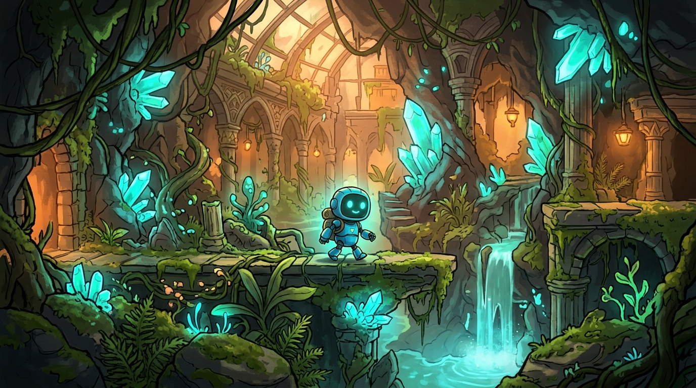
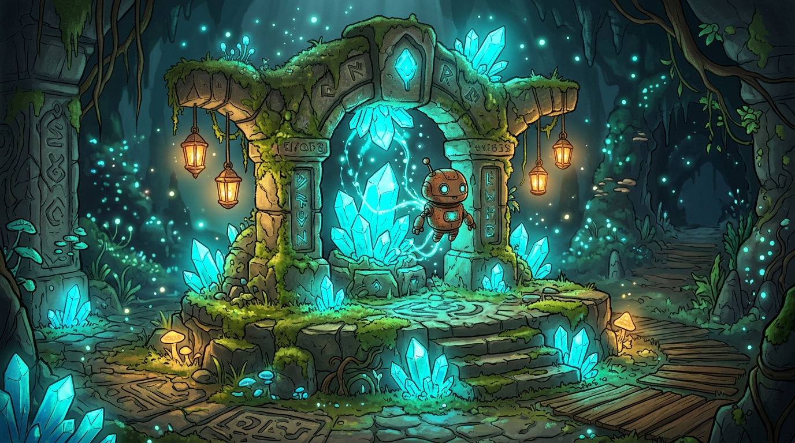

# Глибокий Сад: Пробудження (Deep Garden)

Навчальний ігровий проєкт, розроблений у межах **Практичної роботи №4** («Планування навчального проєкту на канбан-дошці із залученням ШІ-помічника») та **Лекцій 9–10** (розробка та оформлення GDD) з дисципліни «Програмне забезпечення ПК».

---

## 1. Концепція гри (High Concept)

«Глибокий Сад» — це атмосферний 2D-платформер з елементами головоломки. Гравець керує маленьким роботом на ім'я **Іскра (Spark)**, який прокидається в занедбаній підземній біооранжереї. 

Головне завдання — дійти до шлюзу зарядки наступного сектора, контролюючи рівень енергії власного акумулятора та збираючи біолюмінесцентні кристали.

---

## 2. Візуальні референси

| Головний герой у біосаду | Зарядна станція та кристали |
| :---: | :---: |
|  |  |
| *Промпт: 2D indie platformer game concept art, cute small exploratory robot Spark with glowing screen face, navigating ancient overgrown subterranean greenhouse, glowing cyan bio-crystals, mossy ruins.* | *Промпт: Glowing cyan energy crystals embedded in ancient mossy stone shrine, game recharging station for a cute little robot, soft bioluminescent particles.* |

---

## 3. Ключова механіка: Заряд акумулятора

Робот має внутрішню батарею ємністю 100 одиниць:

| Параметр | Значення | Опис |
| :--- | :--- | :--- |
| **Максимальний заряд** | 100% | Початковий стан на старті рівня |
| **Витрата при русі** | 2% / сек | Енергія витрачається під час бігу |
| **Витрата на стрибок** | 1% | Додаткове навантаження на сервоприводи |
| **Пасивна витрата** | 0.25% / сек | Енергія на живлення сенсорів та підсвітки |
| **Приріст від кристала** | +15% | Поповнення при підбиранні кристала |
| **Умова поразки** | Заряд = 0% | Робот зупиняється, рівень перезапускається |
| **Умова перемоги** | Шлюз + 3+ кристали | Відкриття гермодверей до наступного рівня |

---

## 4. Як запустити прототип

Проєкт реалізовано на чистому HTML5 Canvas та JavaScript, тому він працює у будь-якому сучасному веббраузері:

```bash
# Клонування репозиторію
git clone https://github.com/aymarzip/git-practice-4.git

# Перехід у папку
cd git-practice-4
```

Відкрийте файл `index.html` у браузері або через термінал:
```powershell
Start-Process index.html
```

### Керування:
- **A / D** або **← / →** — рух уліво / вправо;
- **W / Пробіл / ↑** — стрибок;
- **R** — миттєвий перезапуск рівня.

---

## 5. Організація роботи та використання ШІ

У ході практичної роботи №4 команда організувала планування за допомогою трьох пов'язаних сервісів:

1. **Notion:** загальна сторінка проєкту, склад команди, опис механік та лог роботи з ШІ.
2. **Trello:** канбан-дошка з колонками *Backlog, To Do, In Progress, Review, Done* та картками кожної механіки з критеріями готовності.
3. **Miro:** полотно мозкового штурму, стікери ідей для сеттингу та голосування.

### Що змінено після відповіді ШІ:
- ШІ спочатку запропонував додати ворогів, систему стрільби лазером та процедурну генерацію рівнів.
- **Рішення команди:** ми відкинули бойову систему та складну процедурність, оскільки за 2 години лабораторної роботи це неможливо якісно реалізувати. Натомість ми зосередилися на чистій і зрозумілій базовій механіці «рух + витрата заряду + збір кристалів», що дозволило завершити повноцінний робочий прототип.

---

## 6. Авторство

- **Розробник:** Aymar
- **Група:** КН-2/1
- **GitHub:** [@aymarzip](https://github.com/aymarzip)
- **Дисципліна:** «Програмне забезпечення ПК» (Розділ ІІ, Тема 3)
